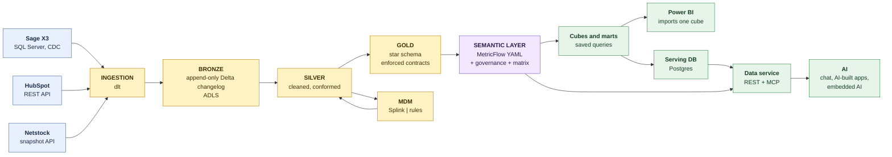

# Architecture

An open-source baseline data platform. Three source systems flow through
bronze, silver and gold into a **semantic layer** that defines every measure
once, and five downstream routes read from it. Every component sits behind a
written contract with a test, so any one of them can be replaced without
touching its neighbours. The why and the decisions are in [PLAN.md](../PLAN.md);
this page is the design as built.

## Architecture and projects

The repo holds one architecture and any number of **project packs**. The
architecture - simulators, ingestion, the MDM engine, the dbt platform
package, the semantic tooling, serving, the Studio, `ctl` - is identical for
every project. A pack under `projects/<slug>/` holds only what a project
decides: its requirements content (metrics, saved queries, backlog, seeds,
golden answers), its synthetic-data settings (`scenario.yml`) and its SQL
(silver intermediate and conformed, and gold). It holds no Python.

```
transform/platform/        dbt package every pack depends on: macros, the staging
                           adapter per source system, project_template.yml
projects/<slug>/
  project.yml              name, systems in use, MDM provider, the architecture version it pins;
                           slots per dashboard and the business's system names
  requirements/            what the business asked for (optional): people, processes, dimensions,
                           bus matrix, dashboards, measures' answers, sketches
  scenario.yml             seed, dates, volumes, companies, sites, name pools
  ingestion/specs|schemas  contracts C1 and C2
  dbt_project.yml          the platform template: only name and vars differ
  models/bronze|silver/intermediate|silver/conformed|gold|semantic
  seeds/  tests/  backlog.yml  golden_answers.yml
  powerbi/  docs/          generated model; open questions, source quirks, the catalogue
```

`core/project.py` is the one place a content path is built. Pick a project
with `python -m ctl --project <slug> ...`, `CT_PROJECT=<slug>` or
`make ... PROJECT=<slug>` (default `sample_v2`). Each project gets its own data
directory, `.data/<slug>/`, and its own dbt target, `projects/<slug>/target/`,
so two projects share nothing: not a manifest, not a row. In Azure each client
gets its own deployment, database and storage account.

The architecture stays identical by construction, not intent:
`python -m ctl check-pack` rejects Python, files outside the layout, staging
models in a pack, a `dbt_project.yml` that strays from the template (so no pack
can make gold a view or turn contracts off), unknown keys in `project.yml` or
`scenario.yml`, a spec table without its bronze model, and an architecture pin
that differs from the platform's version. CI runs every check, the
conformance tests and the golden answers once per pack. The samples here are
fictional and double as the architecture's regression suite; a client's pack
lives in the client's own repo with the architecture as a pinned dependency.

## At a glance



Dagster runs every box as an asset; GitHub Actions and Bicep deploy it to
Azure; Dagster alerts and Azure Monitor watch it; and its own cloud cost comes
back through the pipeline as `gold.fct_cloud_cost`.

## The contracts

| # | Boundary | Contract | Enforced by |
|---|---|---|---|
| C1 | Source → ingestion | the pack's `ingestion/specs/<source>.yml`: tables, keys, strategy, notes | the dlt sources are built from it |
| C2 | Ingestion → bronze | the pack's `ingestion/schemas/<source>.schema.yaml` (frozen columns) and the changelog shape: one append-only Delta table per source table with `_op`, `_change_seq`, `_extracted_at` | dlt schema contract `freeze`; `tests/conformance/test_ingestion_convergence.py` |
| C3 | MDM → silver | `mdm/contract.yml`: `mdm_xref`, `mdm_golden_customer`, `mdm_golden_employee` | `mdm.run.validate`; `tests/conformance/test_mdm_contract.py` |
| C4 | Silver → gold | enforced dbt contracts in the pack's `models/gold/_gold__models.yml` | `dbt build` fails on drift |
| C5 | Gold → semantic layer | the pack's `models/semantic/*.yml` and `backlog.yml`, the compiled `semantic_manifest.json`, `metric_catalog.json` | MetricFlow validation, `python -m semantic.lint`, the golden answers |
| C6 | Semantic → apps and agents | the data service's OpenAPI spec and MCP tool list | `tests/conformance/test_data_service.py` |
| C7 | Platform → serving DB and BI | one table per saved query, plus `dashboard_cube` stacking them all (what Power BI imports) | `tests/conformance/test_dashboard_cube.py`, the Power BI parity queries |
| C8 | Requirements tool → semantic layer | the requirements spec, `semantic/requirements_spec.schema.json`: measures, dashboards, departments, processes, dimensions, the bus matrix and cubes, with people as roles ([requirements_contract.md](requirements_contract.md)) | the product-side compiler validates against the schema and writes only a pack's "what" files; check-pack, the C5 checks and the golden answers then run on them |

## Layers

**Bronze** is what each system sent, never edited. Every extract appends rows
to a Delta table per source table, marked `S` (snapshot), `I`, `U` or `D`
(delete) and ordered by `_change_seq` (the CDC LSN for X3, the extraction time
elsewhere). One macro, `bronze_current`, turns that changelog into current
state for every table and every strategy: start from the latest snapshot, keep
the latest row per key, drop deletes. Bronze is the only layer allowed
engine-specific SQL. A pack has one bronze model per spec table, each a single
`platform.bronze_current(...)` call.

**Silver** cleans (`clean_str`, `x3_date`) and connects. Staging is one view
per source table with no business logic; it belongs to the architecture (the
platform package holds one adapter per source system, switched on by the
pack's `systems`); intermediate models rejoin X3's split
order lines, resolve returns to the line they reverse, derive FX rates from the
GL and classify the three-way match; the conformed models read MDM's output
(C3), so every fact resolves its customer and its employee to a golden key.

**Gold** is the star. Dimensions: date (the conformed calendar, fiscal periods,
and MetricFlow's time spine), customer, employee (with department), department,
item, site, supplier. Facts: sales order line, delivery line, invoice line,
supplier invoice line, inventory count line, deal, forecast accuracy and
cloud cost. Flags are 0/1 integers - they sum, they slice, and T-SQL has no
boolean type. Every column's type is enforced.

| Fact | Date | Customer | Item | Site | Employee (department) | Supplier | Feeds |
|---|:-:|:-:|:-:|:-:|:-:|:-:|---|
| Delivery lines | ship date | ✓ | ✓ | ✓ | ✓ shipper |  | On-Time Delivery |
| Sales order lines | order date | ✓ | ✓ | ✓ | ✓ order taker |  | Return Rate, Order Fill Rate |
| Invoice lines | invoice date | ✓ | ✓ | ✓ |  |  | DSO, Unsettled Invoice Rate, Revenue |
| Supplier invoice lines | invoice date |  | ✓ | ✓ | ✓ buyer | ✓ | Match Rate |
| Inventory count lines | count date |  | ✓ | ✓ | ✓ counter |  | Inventory Accuracy |
| Deals | created / closed | ✓ |  |  | ✓ owner |  | Win Rate, Pipeline Value, Sales Cycle Days |
| Forecast accuracy | period |  | ✓ | ✓ |  |  | Forecast Accuracy |
| Cloud cost | charge date |  |  |  |  |  | Platform Cloud Cost |

A blank cell is a real limit, not a gap to fill: an invoice has no creator, so
DSO cannot be cut by department, and the semantic layer refuses the request
rather than guessing.

## The semantic layer

MetricFlow YAML in the pack's `models/semantic/` is the one place a measure is
defined. Semantic models declare entities (the joins MetricFlow may follow),
dimensions and measures; metrics build on them (simple, ratio, derived,
cumulative); saved queries define the cubes. Governance lives in each
metric's `config.meta`: status (`active`, or `provisional` with a reason),
owner (TBD stays visible), caveats, format, and optionally `requirement`
(`O2C-M1`: the dashboard slot in the requirements tool that asked for it).
Labels are unique within a project. Metrics with no definition yet -
`placeholder` or `blocked` - live in the pack's `backlog.yml` and return a
reason instead of a number everywhere.

**Which dashboard shows a metric is not in the metric.** Two seeds own that:
`process_metric.csv` (process → metric → slot) and `department_metric.csv`
(the process × department matrix: which metrics, in which process, each
department's activities own or contribute to). A metric on two dashboards is
two seed rows, never two definitions.

**Department impact is attributed through the person** (decision D7). X3
documents carry their creator, HubSpot deals their owner; MDM resolves both to
one employee, and seeds map the X3 function profile or HubSpot team to a
department. A department page shows the department's own slice where the
fact carries an employee (`mart_department_scorecard`), and the company-wide
value where it does not (`mart_company_monthly`).

`serving/semantic_service.py` is the only module that imports MetricFlow.
Everything that queries metrics goes through it, so a different semantic
engine is a new implementation of that one module.

## The five routes

| Use case | Route | Computes with |
|---|---|---|
| Dashboards | Power BI imports one table, `marts.dashboard_cube`: every saved query's results stacked, with ratio components. `serving/powerbi.py` generates the model - one measure per KPI, each a guarded `SUM`, `DIVIDE(SUM, SUM)` or single-row value ([powerbi.md](powerbi.md)) | MetricFlow SQL, at fixed grains |
| Data marts | `serving/materialize.py` compiles each saved query into `marts.*` and Parquet | MetricFlow SQL |
| Agentic AI chat | The MCP server (`apps/data_service/mcp_server.py`), over stdio for Claude Code or Streamable HTTP at `/mcp/` | MetricFlow at query time |
| Apps built with AI coding tools | The REST API (`/metrics`, `/query`, `/datasets/...`, OpenAPI at `/docs`) and [AGENTS.md](../AGENTS.md) | MetricFlow and the serving DB |
| Apps with embedded AI | `apps/examples/ask_metrics/`: the Claude API with the same four tools | MetricFlow at query time |

The golden answers check that every route gives the same numbers
([evaluation.md](evaluation.md)).

## What is generated

| Output | Generated by | From |
|---|---|---|
| the pack's `powerbi/ControlTower.SemanticModel/definition/` | `python -m ctl powerbi` | the dbt and semantic manifests |
| the pack's `powerbi/parity/parity_queries.json` | `python -m ctl powerbi` | the golden answers and saved queries |
| the pack's `docs/metric_catalog.md`, `metric_catalog.json/.csv` | `python -m semantic.catalog` | manifests, backlog, seeds |
| the pack's `ingestion/schemas/*.schema.yaml` | `python -m ingestion.run --freeze-schemas` | the sources - review the diff |

CI regenerates the first three and fails if the working tree moves. The frozen
schemas are only ever re-frozen by hand: re-freezing is how a lost column gets
silenced.

## From requirements to a running preview

The requirements tool compiles a workspace into its pack's "what" files
(contract C8, [requirements_contract.md](requirements_contract.md)) and, when
someone presses **Build preview**, asks this repo to rebuild what changed
(`python -m ctl --project <slug> preview`) and report the KPIs (`ctl kpis`).
It writes to this checkout's working tree - one branch for every workspace -
so a preview is an ordinary diff here, gated by check-pack, the lint and the
golden answers before anyone commits it. Numbers show in the tool only in a
labelled preview, and here in the Studio (`?project=<slug>` opens a pack).

## Requirements in the project

A project's `requirements/` holds what the business asked for, each field in
one file: people (the only file with names), processes, dimensions, the bus
matrix, dashboards, each measure's discovery answers, and dashboard sketches.
A measure's definitions - label, description, owner, caveats - stay in the
semantic files, the same lines the Governance page shows. The files' JSON
Schemas and the question sets the screens render from are in
`core/requirements/`; check-pack validates the files and every reference
between them. `seeds/process.csv` and a marked section of
`docs/open_questions.md` are generated from them
(`python -m ctl requirements --regenerate`).

The Studio writes them through `core/requirements/store.py`: one entry
changed through its own lines (every other line byte for byte), the result
checked in a staged copy (schemas, references, the semantic lint on the YAML)
before anything is written, then one local git commit in the editor's name.
It refuses to save over a file with uncommitted changes, and never pushes.

## Running it

[running.md](running.md). Components one by one, with how to swap each:
[components.md](components.md).
